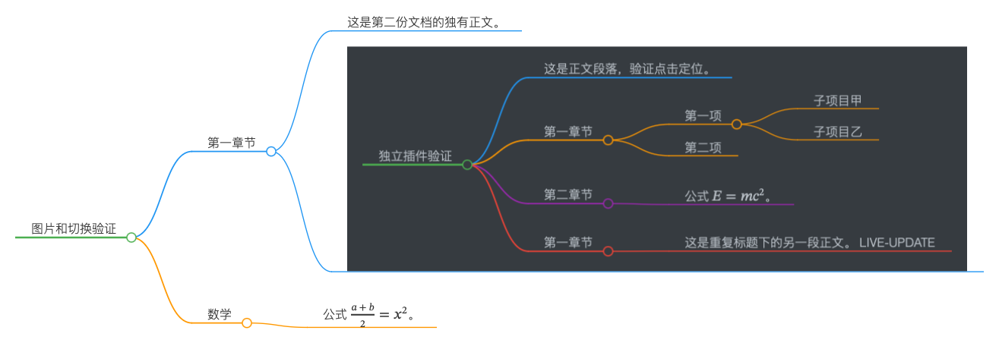

# Markmap Plus：Typora 思维导图插件

Markmap Plus 是基于 Markmap 的独立 Typora 插件，将 Markdown 标题、段落和列表转换为可交互思维导图。点击导图节点即可定位正文，适合阅读长文档、整理知识笔记和查看文章结构。

An independent Typora mind map plugin powered by Markmap: navigate Markdown with interactive mind maps and export offline HTML, SVG or PNG.

[下载最新版 plugin.zip](https://github.com/yjcdon/typora-plugin-markmap-plus/releases/latest/download/plugin.zip) · [版本说明](https://github.com/yjcdon/typora-plugin-markmap-plus/releases) · [AI 安装说明](INSTALL.md)

## 功能

- **用导图阅读 Markdown**：展示标题、正文段落和嵌套列表；点击文字定位并高亮对应正文，点击圆点折叠或展开分支。
- **跟随编辑更新**：编辑内容后刷新导图，同文档更新保留可匹配的折叠状态。
- **调整阅读布局**：拖动浮窗、调整尺寸、固定到左侧或右侧，使用缩放和适应视图聚焦阅读位置。
- **选择内容层级**：默认显示全部标题与正文；设置为 1～5 时，显示标题并按对应层级展开。
- **导出和分享**：生成可交互 HTML、SVG 矢量图或 PNG 图片；本地图片与数学公式可随导图导出。
- **独立设置与主题**：设置保存在插件目录中，界面跟随 Typora 的 GitHub、Night 主题。



*PNG 导出示例。HTML 导出还支持缩放、分支折叠和黑白背景切换。*

## 平台与版本

当前版本为 **2.0.1 独立版**，采用独立启动入口和设置存储，交付为一个 `markmap-plus` 文件夹。

| 平台 | 验证状态 |
| --- | --- |
| macOS | 已实测 macOS 27.2、Apple Silicon arm64、Typora 1.12.3 |
| Windows 10 | 保留平台适配实现，实机验收列为后续任务 |

其他 Typora 版本和系统组合按实际环境验证。详细操作结果、资源释放检查与大文档采样见[验证记录](docs/05-验证记录.md)。

## 安装：交给 AI，重启即可使用

1. 下载 [plugin.zip](https://github.com/yjcdon/typora-plugin-markmap-plus/releases/latest/download/plugin.zip)，解压得到 `markmap-plus` 文件夹。
2. 将文件夹交给具备本地文件操作能力的 AI，让它阅读并执行其中的 `INSTALL.md`。
3. 安装完成后重启 Typora，点击右下角按钮打开思维导图。

AI 会识别 Typora 安装位置，将插件放入用户数据目录，并在 Typora 页面配置一个专属启动入口。macOS 默认插件目录为：

```text
~/Library/Application Support/abnerworks.Typora/markmap-plus
```

可以直接向 AI 提出：

> 请按这个文件夹中的 INSTALL.md 安装 Markmap Plus，保留已有设置，完成后重启 Typora，验证导图和一次导出。

从 1.x 社区框架版升级时，AI 按安装说明迁移旧设置并停用旧 Markmap 实例。2.0.0 使用独立目录和独立入口，升级过程详见 [INSTALL.md](INSTALL.md)。

## 开始使用

在 Typora 打开一份包含标题的 Markdown 文档，点击右下角的思维导图按钮（左侧节点连接右侧三个分支节点）。点击导图中的标题、段落或列表项可跳转正文；点击分支圆点可折叠或展开。工具栏提供左右固定、缩放、适应视图、导出和设置。

点击“导出”后，选择横向排列的 HTML、SVG 或 PNG 按钮；点击面板外部或按 Esc 关闭。

在设置的“导出目录”中点击“选择文件夹”，通过系统对话框选择目录，再点击“保存修改”生效。路径以只读方式显示，默认使用下载目录；取消选择保留当前目录。

| 格式 | 用途与内容 |
| --- | --- |
| HTML | 独立交互文件，保留全部节点与折叠状态，携带运行时、样式、字体及可读取的本地图片 |
| SVG | 矢量图片，导出当前展开内容，适合排版和后续编辑 |
| PNG | 普通图片，导出当前展开内容，适合插入笔记或分享 |

程序、样式和字体随包提供。本地图片与公式已在宿主页隔离外网请求的环境中验证；外部图片的可用性取决于其原始地址。

## 更新与卸载

**更新**：让 AI 按 `INSTALL.md` 替换程序，保留 `data` 目录，核对启动入口后重启。

**停用**：退出 Typora，将 `markmap-plus` 文件夹移到废纸篓，再重启。

**完整卸载**：让 AI 按 `INSTALL.md` 清理 Markmap Plus 的专属入口，并将插件目录和设置移到废纸篓。Typora 升级覆盖入口时，也可由 AI 按说明重新配置。

## 开发与文档

```sh
git clone https://github.com/yjcdon/typora-plugin-markmap-plus.git
cd typora-plugin-markmap-plus
pnpm install
pnpm check
pnpm build:prod
```

构建生成 `dist/markmap-plus` 和 `plugin.zip`。构建工具将上一次产物移入系统废纸篓，工作目录保留最新构建。

- [产品方案](docs/01-产品方案.md) · [技术方案](docs/02-技术方案.md)
- [任务清单](docs/03-任务清单.md) · [测试用例](docs/04-测试用例.md) · [验证记录](docs/05-验证记录.md)
- [AI 安装、迁移与恢复说明](INSTALL.md)

## 许可与致谢

本项目采用 [MIT License](src/NOTICE.md)，保留原始版权与许可文本。发布包同时提供实际打包依赖的许可证。

本项目沿用 [util6/typora-plugin-markmap-plus](https://github.com/util6/typora-plugin-markmap-plus) 的导图能力，感谢原作者及 [plylrnsdy](https://github.com/plylrnsdy) 的工作。思维导图转换与渲染基于 [Markmap](https://github.com/markmap/markmap)。
